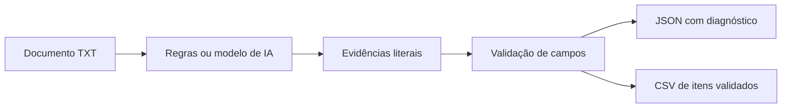

# Fluxa

Extração de dados de documentos de texto para JSON e CSV, com evidências literais e validação antes da exportação.

**Problema:** copiar dados de documentos para planilhas exige conferência e pode introduzir erros. Este projeto organiza a extração em uma sequência verificável: ler, extrair, validar e separar itens para revisão.

## Fluxo



## Executar sem API

Python 3.11 ou superior. Sem dependências externas. Abra o terminal na pasta do projeto.

```powershell
python app.py samples/invoice-complete.txt --output outputs/complete
python app.py samples --output outputs/batch
```

O primeiro comando termina com código 0 e exporta o valor `1490.50`. O segundo encontra um documento sem vencimento: termina com código 1, registra o diagnóstico em `results.json` e exporta somente o documento completo para `validated.csv`. O modo padrão `rules` é determinístico, sem IA.

## Executar com IA

Após configurar as variáveis de ambiente descritas abaixo:

```powershell
python app.py samples/invoice-complete.txt --provider openai --output outputs/live
```

O modelo extrai valores e citações. O código verifica se as citações existem no documento, se contêm os valores, se o total usa o formato brasileiro e se o vencimento é uma data real. Campos ausentes seguem para revisão. Cada execução tem limite de 20 documentos e 40.000 caracteres por documento.

## Decisões e limites

- Nesta versão, a entrada é texto UTF-8 `.txt`. Não há OCR nem processamento direto de PDF ou imagens.
- O valor monetário aceita BRL no formato brasileiro e é normalizado com `Decimal`, evitando arredondamentos binários.
- Campos potencialmente interpretados como fórmula são escapados na exportação CSV.
- Evidência literal reduz saídas sem fonte, mas não garante que o trecho correto foi interpretado. A revisão humana continua necessária.
- Os rótulos fixos do extrator por regras são uma referência comparável; o modelo pode receber textos com outra organização, sem garantia prévia de qualidade.
- `validated` significa que as validações implementadas passaram. Não comprova autenticidade de um documento nem autoriza pagamento.
- Relatórios são regravados no diretório de saída escolhido. Use diretórios distintos para preservar execuções.

## O que demonstra

Python, integração de API, saídas estruturadas, processamento em lote, validação de dados, evidências, exportação e testes de erros.

## IA real e demonstrações locais

A integração real usa a Responses API da OpenAI e JSON Schema. Configure `OPENAI_API_KEY` e `OPENAI_MODEL` nas variáveis de ambiente, escolhendo um modelo compatível com Structured Outputs. Não há modelo fixo ou chave incluída. Arquivos `.env` não são carregados automaticamente.

Os modos locais não chamam um modelo e não devem ser apresentados como resultados de IA. Os testes usam respostas simuladas de rede. A integração real ainda precisa ser validada com uma chave e um modelo disponíveis na sua conta.

No modo OpenAI, o conteúdo enviado como entrada é transmitido ao serviço. Use os dados fictícios incluídos para começar. A chave fica no ambiente e não entra no código, nos relatórios ou nos logs. A configuração `store=false` é enviada à API; ela não substitui a política de tratamento de dados do provedor.

## Testes

```powershell
python -m unittest discover -s tests -v
```

O fluxo de testes do GitHub Actions usa apenas casos locais e respostas simuladas, sem credenciais de IA. O workflow está preparado, mas a execução no GitHub depende da publicação do repositório.

## Contexto do projeto

Projeto de portfólio de João Carlos Minozzi, desenvolvido com assistência de IA. Os exemplos são fictícios e não representam implantação em clientes ou uso em produção. As decisões e limitações estão documentadas para apoiar estudo, revisão e evolução do código.

Referência de integração: [Structured Outputs](https://developers.openai.com/api/docs/guides/structured-outputs).
